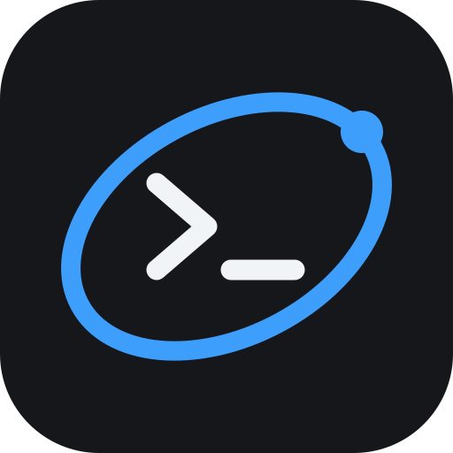
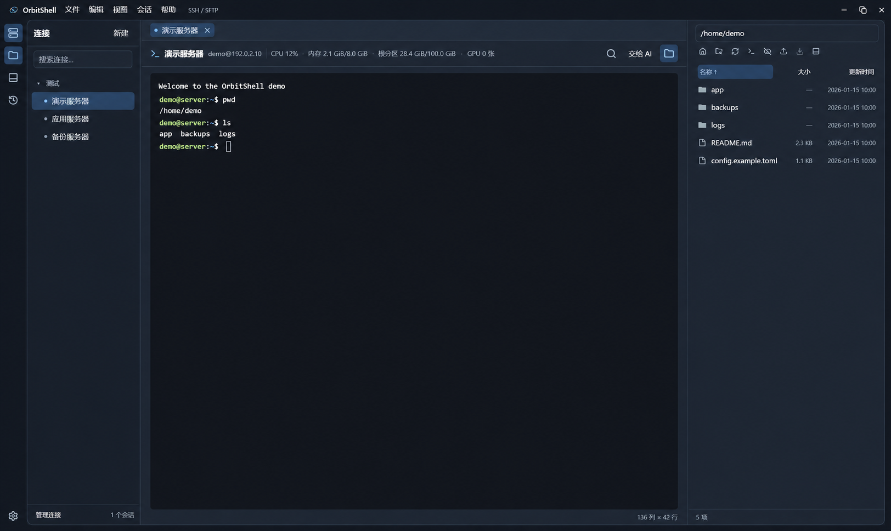

<p align="center">
  
</p>
<h1 align="center">OrbitShell</h1>
<p align="center"><strong>A native Windows SSH and SFTP workspace for people and AI agents.</strong></p>

<p align="center">
  <strong>English</strong> · <a href="README.zh-CN.md">简体中文</a>
</p>

<p align="center">
  <a href="https://github.com/IndigoCloud6/OrbitShell/releases/latest/download/OrbitShell-windows-x64.zip"></a>
</p>

<p align="center">
  Portable ZIP · <a href="https://github.com/IndigoCloud6/OrbitShell/releases/latest">Latest release and checksum</a> · <a href="LICENSE">Apache License 2.0</a>
</p>



*The screenshot shows demo connections and files.*

## What you can do

- Manage multiple SSH sessions with grouped connections, password or OpenSSH key authentication, and host fingerprint verification.
- Browse and edit remote files, drag files in or out over SFTP, and track transfer progress and history.
- Open temporary sessions from bastion host links or Xshell-style arguments. Export SSH diagnostics that contain protocol metadata.
- Connect an MCP client to open a dedicated AI terminal, hand over an existing session with approval, or submit SFTP transfers. OrbitShell checks AI commands against its command guard.
- Use quick commands, command history, terminal search, adjustable panels, and the Windows system tray.

## Run on Windows

1. Download the [Windows x64 ZIP](https://github.com/IndigoCloud6/OrbitShell/releases/latest/download/OrbitShell-windows-x64.zip) and extract it.
2. Open `OrbitShell.exe`. For your first connection, compare the SSH host fingerprint with the one provided by your server administrator.
3. If your bastion host launcher expects an Xshell-style entry point, select the bundled `Xshell.exe`. Keep it beside `OrbitShell.exe` so it can forward the launch arguments.

See the [GPUI workbench guide](prototypes/gpui-terminal/README.md) for bastion host setup, diagnostics, and MCP settings.

## Build from source

Install the Rust MSVC toolchain and Visual Studio C++ Build Tools with the Windows SDK. The default `gpui` branch builds with Cargo.

```powershell
git clone https://github.com/IndigoCloud6/OrbitShell.git
cd OrbitShell
cargo run --locked --manifest-path prototypes/gpui-terminal/Cargo.toml
```

Build the main app and the optional Xshell adapter in Release mode.

```powershell
cargo build --release --locked --manifest-path prototypes/gpui-terminal/Cargo.toml --bins
```

The executable files are under `prototypes/gpui-terminal/target/release/`. If you copy the main executable to another folder, you can name it `OrbitShell.exe`.

## Branches and releases

| Version | Source | Releases |
| --- | --- | --- |
| Rust + GPUI | [`gpui`](https://github.com/IndigoCloud6/OrbitShell/tree/gpui), the default branch | [Latest GPUI release](https://github.com/IndigoCloud6/OrbitShell/releases/latest) |
| Original Tauri + React | [`main`](https://github.com/IndigoCloud6/OrbitShell/tree/main) | [Tauri v0.1.0](https://github.com/IndigoCloud6/OrbitShell/releases/tag/v0.1.0) |

## License

OrbitShell's own code on this branch is licensed under the [Apache License 2.0](LICENSE). See [third-party notices](THIRD_PARTY_NOTICES.md) for bundled components.
