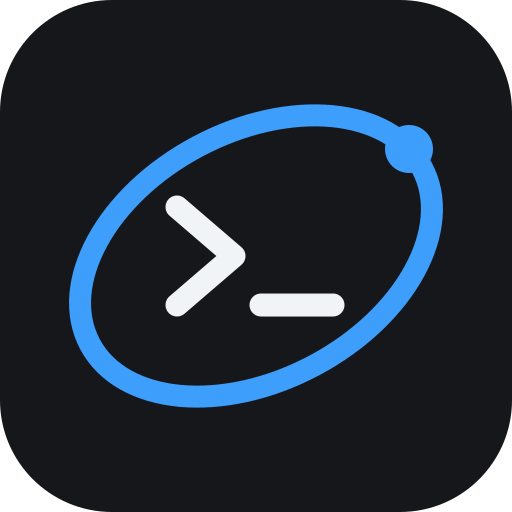
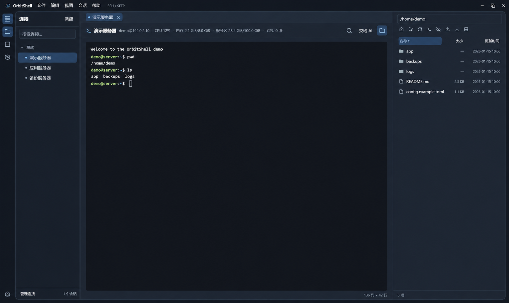

<p align="center">
  
</p>
<h1 align="center">OrbitShell</h1>
<p align="center"><strong>面向人工和 AI 协作的 Windows 原生 SSH / SFTP 工作台。</strong></p>

<p align="center">
  <a href="README.md">English</a> · <strong>简体中文</strong>
</p>

<p align="center">
  <a href="https://github.com/IndigoCloud6/OrbitShell/releases/download/v0.2.1/OrbitShell-0.2.1-windows-x64-setup.exe"></a>
</p>

<p align="center">
  Windows x64 安装包 · <a href="https://github.com/IndigoCloud6/OrbitShell/releases/latest">最新版与校验值</a> · <a href="LICENSE">Apache 2.0 许可证</a>
</p>



*图中使用演示连接和文件。*

## 功能

- 管理多标签 SSH 会话和连接分组，支持密码、OpenSSH 私钥和主机指纹确认。
- 浏览和编辑远程文件，通过 SFTP 拖放上传和下载，查看实际进度和传输记录。
- 通过堡垒机会话链接或 Xshell 风格参数打开临时会话，按需导出只包含协议元数据的 SSH 诊断。
- 通过 MCP 使用独立 AI 终端、经用户确认接管已有会话或提交 SFTP 传输。OrbitShell 会对 AI 命令应用危险命令拦截规则。
- 使用快捷指令、命令历史、终端查找、可调面板和 Windows 系统托盘。

## 在 Windows 上运行

1. 下载并运行 [Windows x64 安装包](https://github.com/IndigoCloud6/OrbitShell/releases/download/v0.2.1/OrbitShell-0.2.1-windows-x64-setup.exe)。
2. 从开始菜单打开 **OrbitShell**。首次连接时，与服务器管理员提供的 SSH 主机指纹核对。
3. 如果堡垒机助手需要 Xshell 风格的客户端入口，选择安装目录下的 `Xshell.exe`。

堡垒机设置、SSH 诊断与 MCP 操作见 [GPUI 工作台使用说明](prototypes/gpui-terminal/README.md)。

## 从源码构建

安装 Rust MSVC 工具链和 Visual Studio C++ Build Tools（含 Windows SDK）。默认的 `main` 分支使用 Cargo 构建。

```powershell
git clone https://github.com/IndigoCloud6/OrbitShell.git
cd OrbitShell
cargo run --locked --manifest-path prototypes/gpui-terminal/Cargo.toml
```

构建 Release 主程序和可选的 Xshell 转接器。

```powershell
cargo build --release --locked --manifest-path prototypes/gpui-terminal/Cargo.toml --bins
```

程序位于 `prototypes/gpui-terminal/target/release/`。复制主程序到常用目录后，可将其命名为 `OrbitShell.exe`。

## 分支与发布

| 版本 | 源码 | 发布 |
| --- | --- | --- |
| Rust + GPUI | [`main`](https://github.com/IndigoCloud6/OrbitShell/tree/main)，默认分支 | [GPUI 最新版](https://github.com/IndigoCloud6/OrbitShell/releases/latest) |
| 原 Tauri + React 版 | [`tauri`](https://github.com/IndigoCloud6/OrbitShell/tree/tauri) | [Tauri v0.1.0](https://github.com/IndigoCloud6/OrbitShell/releases/tag/v0.1.0) |

## 开源协议

当前分支的 OrbitShell 原创代码采用 [Apache License 2.0](LICENSE)。随项目分发的第三方组件见[第三方许可说明](THIRD_PARTY_NOTICES.md)。
